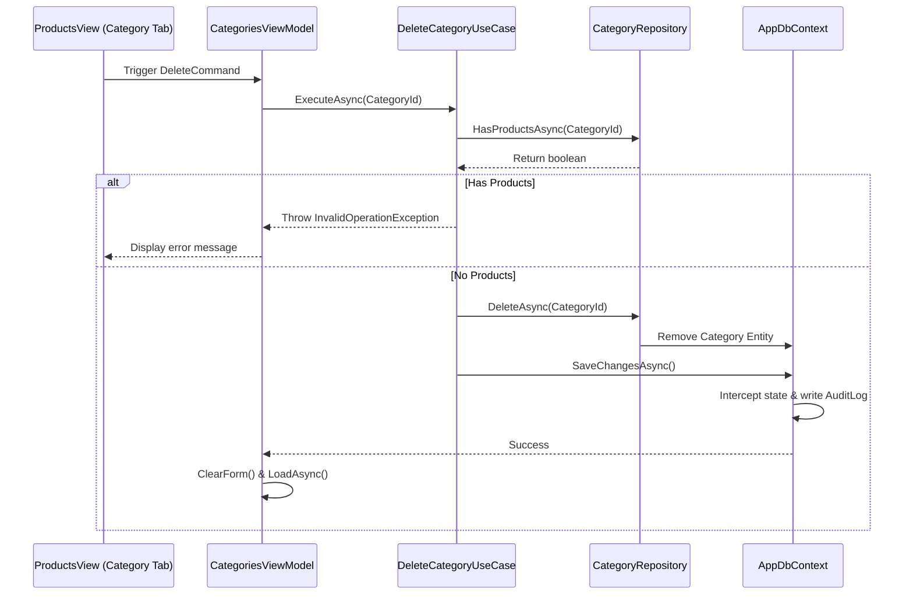

# Technical Design: Category Deletion, Audit Log Filtering & Login Flow

## Technical Approach
We will implement the deletion of Categories adhering to the project's Clean Architecture structure. Since `AppDbContext` handles automated entity change-tracking and records audit logs (for `Added`, `Modified`, `Deleted` states) on `SaveChangesAsync`, deleting a category will automatically produce an audit log. The `DeleteCategoryUseCase` will enforce validation that no active products are associated with the category before deleting it. 

We will also update `AuditLogViewModel` to support filtering by `"Categoría"` (mapping to entity name `"Category"`), and document the security-conscious login flow which uses code-behind handling to bind password updates safely.

## Architecture Decisions
- **Delete Integrity**: Perform validation checks via `ICategoryRepository.HasProductsAsync()` in the Use Case rather than relying on database foreign key constraint exceptions.
- **Repository Extension**: Add `DeleteAsync` directly to `ICategoryRepository` to support hard-delete.
- **Audit Logging**: Leverage the existing `AppDbContext` change tracker for automatic audit trail creation on category delete.
- **User Interface**: Present a "Eliminar" button in the categories editor, visibility-controlled by the presence of a selected category using `NullToVisibilityConverter`.

## Data Flow


## File Changes

### Domain & Application Layers
- `src/POS.Domain/Interfaces/ICategoryRepository.cs`
  - Add `Task DeleteAsync(Guid id, CancellationToken cancellationToken = default);`
- `src/POS.Application/UseCases/Categories/DeleteCategoryUseCase.cs`
  - Implement business logic: verify category existence, check `HasProductsAsync()`, delete via repository, and save changes via `IUnitOfWork`.

### Infrastructure Layer
- `src/POS.Infrastructure/Persistence/Repositories/CategoryRepository.cs`
  - Implement `DeleteAsync` by fetching and removing the category from the `DbSet<Category>`.
- `src/POS.Infrastructure/DependencyInjection.cs`
  - Register `DeleteCategoryUseCase` as a scoped service.

### Presentation Layer
- `src/POS.Presentation.Shared/ViewModels/CategoriesViewModel.cs`
  - Inject `DeleteCategoryUseCase` in constructor.
  - Implement `DeleteCommand` (of type `RelayCommand`) and asynchronous `DeleteAsync()` logic.
  - Update `SelectedCategory` setter to call `command.RaiseCanExecuteChanged()` on `DeleteCommand`.
- `src/POS.Presentation/AppBootstrapper.cs`
  - Instantiate `CategoriesViewModel` passing the injected `DeleteCategoryUseCase`.
- `src/POS.Presentation/Views/ProductsView.xaml`
  - Add a styled "Eliminar" button next to "Limpiar" in the category form.
  - Bind `Command` to `DeleteCommand` and `Visibility` to `SelectedCategory` using `NullToVisibilityConverter`.
- `src/POS.Presentation.Shared/ViewModels/AuditLogViewModel.cs`
  - Add `"Categoría"` to `AvailableEntityFilters` list.

## Interfaces / Contracts
```csharp
public interface ICategoryRepository
{
    // Existing methods...
    Task DeleteAsync(Guid id, CancellationToken cancellationToken = default);
}

public sealed class DeleteCategoryUseCase
{
    public DeleteCategoryUseCase(ICategoryRepository categories, IUnitOfWork unitOfWork);
    public Task ExecuteAsync(Guid categoryId, CancellationToken cancellationToken = default);
}
```

## Testing Strategy
- **DeleteCategoryUseCaseTests**:
  - Test throwing `InvalidOperationException` when category does not exist.
  - Test throwing `InvalidOperationException` when category has associated active products.
  - Test successful deletion and `SaveChangesAsync` call when there are no products.
- **CategoriesViewModelTests**:
  - Test that `DeleteCommand.CanExecute` is false when `SelectedCategory` is null, and true when it is set.
  - Test that executing `DeleteCommand` invokes `DeleteCategoryUseCase` and triggers category list reload.

## Migration / Rollout
No database schema changes or migrations are needed since the existing model already includes `Categories` and auditing. This change only adds deletion capabilities, view model behaviors, and UI filters.

## Open Questions
- *Soft Delete vs Hard Delete*: We decided to implement hard delete (`Remove` from DB) because Categories are metadata entities and deleting them is only allowed when no products are associated, keeping database referential integrity intact.
