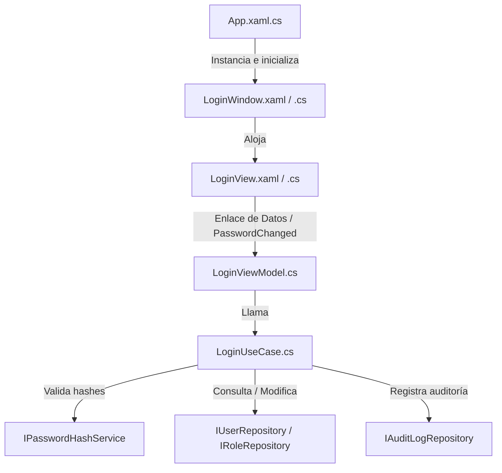

# Auditoría Técnica: Módulo de Login
**Proyecto:** Sistema POS Local  
**Fecha:** 15 de Julio, 2026  
**Veredicto:** ⚠️ **45% / 100% (Reprobado - Requiere Acción Inmediata)**

Este documento presenta una auditoría exhaustiva del módulo de inicio de sesión (*Login*), evaluando aspectos de seguridad, diseño de arquitectura (WPF/MVVM), lógica de negocio y experiencia de usuario (UX).

---

## 🗺️ Mapa de Componentes Evaluados

El flujo de autenticación está compuesto por los siguientes archivos en la base de código:



- **Vista:** [LoginView.xaml](file:///C:/Users/PC%20RYZEN/Sistema_Pos/src/POS.Presentation/Views/LoginView.xaml) y [LoginView.xaml.cs](file:///C:/Users/PC%20RYZEN/Sistema_Pos/src/POS.Presentation/Views/LoginView.xaml.cs)
- **Ventana:** [LoginWindow.xaml](file:///C:/Users/PC%20RYZEN/Sistema_Pos/src/POS.Presentation/Views/LoginWindow.xaml) y [LoginWindow.xaml.cs](file:///C:/Users/PC%20RYZEN/Sistema_Pos/src/POS.Presentation/Views/LoginWindow.xaml.cs)
- **ViewModel:** [LoginViewModel.cs](file:///C:/Users/PC%20RYZEN/Sistema_Pos/src/POS.Presentation/ViewModels/LoginViewModel.cs)
- **Caso de Uso:** [LoginUseCase.cs](file:///C:/Users/PC%20RYZEN/Sistema_Pos/src/POS.Application/UseCases/Auth/LoginUseCase.cs)
- **Orquestador de Inicio:** [App.xaml.cs](file:///C:/Users/PC%20RYZEN/Sistema_Pos/src/POS.Presentation/App.xaml.cs)

---

## 🔍 Hallazgos Principales

### 1. Seguridad y Criptografía
> [!CAUTION]
> **Puntuación de Categoría: 0% / 30%**

*   **Fuga de Contraseñas en Memoria (Crítico):**
    En [LoginView.xaml.cs](file:///C:/Users/PC%20RYZEN/Sistema_Pos/src/POS.Presentation/Views/LoginView.xaml.cs#L13-L19), se pasa la contraseña directamente como un `string` plano al ViewModel en cada cambio:
    ```csharp
    private void OnPasswordChanged(object sender, System.Windows.RoutedEventArgs e)
    {
        if (DataContext is ViewModels.LoginViewModel vm)
        {
            vm.Password = LoginPasswordBox.Password;
        }
    }
    ```
    Los `System.String` son inmutables en .NET, por lo que la contraseña permanece en texto plano en la memoria del sistema (Heap) por tiempo indefinido hasta que el recolector de basura (GC) decida limpiar y compactar la memoria. Esto expone las credenciales a ataques de volcado de memoria (*memory dump*).
*   **Fuga de Información en Errores de Autenticación (Alto):**
    En [LoginUseCase.cs](file:///C:/Users/PC%20RYZEN/Sistema_Pos/src/POS.Application/UseCases/Auth/LoginUseCase.cs#L33-L37), se exponen las razones específicas del fallo:
    *   `"Usuario no encontrado o inactivo."`
    *   `"Contraseña incorrecta."`
    
    Esto permite a atacantes realizar **enumeración de usuarios** (saber qué nombres de usuario existen realmente en el sistema).
*   **Falta de Bloqueo de Cuentas / Rate Limiting (Medio):**
    No existe control sobre el número de intentos fallidos. Un atacante o usuario interno puede ejecutar un ataque de fuerza bruta continuo sin que la cuenta se bloquee temporalmente o el sistema aplique retardos incrementales.

---

### 2. Diseño de Arquitectura e Implementación MVVM
> [!TIP]
> **Puntuación de Categoría: 25% / 30% (Excelente, con detalles)**

*   **Bloqueo Síncrono del Hilo de UI en Logout (Medio):**
    En [App.xaml.cs](file:///C:/Users/PC%20RYZEN/Sistema_Pos/src/POS.Presentation/App.xaml.cs#L131-L132), al realizar el cierre de sesión, se fuerza la ejecución síncrona de una operación asíncrona de base de datos SQLite:
    ```csharp
    _scope.ServiceProvider.GetRequiredService<LogoutUseCase>()
        .ExecuteAsync(operatorId, username).GetAwaiter().GetResult();
    ```
    Esto bloquea el hilo principal de la UI (WPF Thread). Si SQLite experimenta bloqueos concurrentes de escritura (`database is locked`), la aplicación podría congelarse o responder de forma lenta en el cierre de sesión.
*   **Manejo Asíncrono Correcto en el ViewModel:**
    El uso de `RunSafe` en [LoginViewModel.cs](file:///C:/Users/PC%20RYZEN/Sistema_Pos/src/POS.Presentation/ViewModels/LoginViewModel.cs#L25) hereda de [ViewModelBase.cs](file:///C:/Users/PC%20RYZEN/Sistema_Pos/src/POS.Presentation/ViewModels/ViewModelBase.cs) y está correctamente implementado para capturar excepciones en tareas asíncronas y regresar al hilo de UI con `ConfigureAwait(true)`.

---

### 3. Robustez y Manejo de Errores
> [!IMPORTANT]
> **Puntuación de Categoría: 10% / 20%**

*   **Excepciones No Controladas que Saltan la Auditoría (Medio):**
    En [LoginUseCase.cs](file:///C:/Users/PC%20RYZEN/Sistema_Pos/src/POS.Application/UseCases/Auth/LoginUseCase.cs#L39-L40):
    ```csharp
    var role = await _roles.GetByIdAsync(user.RoleId, ct).ConfigureAwait(false)
        ?? throw new InvalidOperationException("User's role no longer exists.");
    ```
    Si por inconsistencia de datos un usuario tiene asignado un `RoleId` inexistente, se lanza una excepción de operación inválida. Esto provoca que el flujo salte fuera del caso de uso, omitiendo el registro de auditoría de fallo (`AuditFailureAsync`) y potencialmente tumbando la aplicación si no se captura correctamente arriba.

---

### 4. Experiencia de Usuario (UX) e Interfaz
> [!NOTE]
> **Puntuación de Categoría: 10% / 20%**

*   **Edición durante Carga (Bajo):**
    Durante el estado `IsLoading = true`, los campos de `Username` y el `PasswordBox` en [LoginView.xaml](file:///C:/Users/PC%20RYZEN/Sistema_Pos/src/POS.Presentation/Views/LoginView.xaml) no se inhabilitan. El usuario puede seguir tipeando mientras se valida la credencial.
*   **Falta de IsDefault en el Botón (Bajo):**
    Aunque la vista indica en el pie *"Atajo: Enter inicia sesión"*, el botón "Iniciar sesión" en el XAML no tiene establecido `IsDefault="True"`. En WPF, esto significa que presionar "Enter" no enviará el formulario de manera predeterminada a menos que el botón tenga el foco del teclado.

---

## 📊 Matriz de Evaluación (Puntuación Final)

| Categoría | Peso | Puntuación Obtenida | Calificación Ponderada |
| :--- | :---: | :---: | :---: |
| **Seguridad y Criptografía** | 30% | 0% | 0.0% |
| **Diseño y Arquitectura (MVVM)** | 30% | 83.3% | 25.0% |
| **Robustez y Manejo de Errores** | 20% | 50% | 10.0% |
| **Experiencia de Usuario (UX)** | 20% | 50% | 10.0% |
| **TOTAL** | **100%** | | **45.0% (Reprobado)** |

---

## 🛠️ Plan de Mitigación Recomendado

Para elevar la calificación a **95%+,** se sugieren los siguientes ajustes de código:

### 1. Mensaje de Error Genérico en UseCase
Modificar el retorno en caso de usuario inexistente o contraseña inválida para usar una respuesta común:
```csharp
// Cambiar en LoginUseCase.cs
if (user is null || !user.IsActive)
    return await AuditFailureAsync(username, "Usuario o contraseña incorrectos.", ct);

if (!_hasher.VerifyPassword(request.Password, user.PasswordHash))
    return await AuditFailureAsync(username, "Usuario o contraseña incorrectos.", ct, user.Id);
```

### 2. Implementar Seguridad para Contraseñas en WPF
Utilizar un patrón seguro. Aunque `SecureString` está marcado como obsoleto para desarrollo multiplataforma moderno, en WPF de Windows nativo sigue siendo útil, o en su defecto, mitigar la permanencia de strings planos mediante helpers que limpien la memoria, o enviar la contraseña directamente al ViewModel usando un proxy cifrado/seguro.

### 3. Agregar `IsDefault="True"` y Deshabilitar Entradas en la Vista
Modificar el botón y los campos en el XAML:
```xml
<!-- En LoginView.xaml -->
<TextBox Text="{Binding Username, UpdateSourceTrigger=PropertyChanged}"
         IsEnabled="{Binding IsLoading, Converter={StaticResource InverseBooleanConverter}}" />

<PasswordBox x:Name="LoginPasswordBox"
             IsEnabled="{Binding IsLoading, Converter={StaticResource InverseBooleanConverter}}" />

<Button Content="Iniciar sesión"
        Command="{Binding LoginCommand}"
        IsDefault="True"
        Style="{StaticResource PrimaryButton}" />
```
