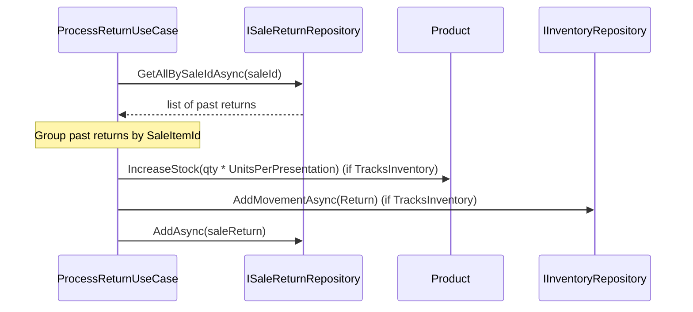

# Technical Design: Fix Inventory Bugs

## Technical Approach

To fix the five identified inventory bugs, we will introduce domain validations, database schema adjustments, and repository interface modifications. All stock operations will enforce the `TracksInventory` invariant. Past sales returns will be tracked precisely per line using `SaleItemId` instead of being grouped globally by product, preventing cross-line calculation errors. Stock cancellations and ledger reasons on completing draft sales will be aligned.

---

## Architecture Decisions

### 1. TracksInventory Stock Guard
In [Product](file:///C:/Users/PC%20RYZEN/Sistema_Pos/src/POS.Domain/Entities/Product.cs), modify `IncreaseStock` and `DecreaseStock` to return early if `TracksInventory` is false.
```csharp
public void IncreaseStock(Quantity quantity)
{
    if (!TracksInventory) return;
    CurrentStock += quantity.Value;
}
```
In [AdjustStockUseCase](file:///C:/Users/PC%20RYZEN/Sistema_Pos/src/POS.Application/UseCases/Inventory/AdjustStockUseCase.cs), check `product.TracksInventory`. Throw an `InvalidOperationException` if a non-tracked product is adjusted manually.

### 2. Precise Returns by SaleItemId
Add a non-nullable `SaleItemId` property to [SaleReturnItem](file:///C:/Users/PC%20RYZEN/Sistema_Pos/src/POS.Domain/Entities/SaleReturnItem.cs) and configure its EF mapping as a string-converted field in [SaleReturnItemConfiguration](file:///C:/Users/PC%20RYZEN/Sistema_Pos/src/POS.Infrastructure/Persistence/Configurations/SaleReturnItemConfiguration.cs).
In [ProcessReturnUseCase](file:///C:/Users/PC%20RYZEN/Sistema_Pos/src/POS.Application/UseCases/Invoices/ProcessReturnUseCase.cs), query past returns and group them by `SaleItemId` instead of `ProductId` to ensure line-level isolation for returns.

### 3. Sale Cancellation Quantities and Tracking checks
Update [CancelSaleUseCase](file:///C:/Users/PC%20RYZEN/Sistema_Pos/src/POS.Application/UseCases/Invoices/CancelSaleUseCase.cs) and [CancelHeldSaleUseCase](file:///C:/Users/PC%20RYZEN/Sistema_Pos/src/POS.Application/UseCases/Sales/CancelHeldSaleUseCase.cs) to check `product.TracksInventory` before restoring stock and recording movements. In [CancelSaleUseCase](file:///C:/Users/PC%20RYZEN/Sistema_Pos/src/POS.Application/UseCases/Invoices/CancelSaleUseCase.cs), scale the quantity restored by multiplying `item.Quantity` by `item.UnitsPerPresentation`.

### 4. Align Ledger Reasons on Draft Completion
Add `UpdateReason` to [InventoryMovement](file:///C:/Users/PC%20RYZEN/Sistema_Pos/src/POS.Domain/Entities/InventoryMovement.cs). Add `GetMovementsByReferenceIdAsync` to [IInventoryRepository](file:///C:/Users/PC%20RYZEN/Sistema_Pos/src/POS.Domain/Interfaces/IInventoryRepository.cs) and its EF implementation. When completing a draft in [CompleteHeldSaleUseCase](file:///C:/Users/PC%20RYZEN/Sistema_Pos/src/POS.Application/UseCases/Sales/CompleteHeldSaleUseCase.cs), query movements by sale ID and update their reason from `"Venta en espera"` to `"Venta"`.

---

## Data Flow
For a partial return:


---

## File Changes

| File Path | Action | Description |
| :--- | :--- | :--- |
| [Product.cs](file:///C:/Users/PC%20RYZEN/Sistema_Pos/src/POS.Domain/Entities/Product.cs) | Modify | Enforce `TracksInventory` guard in `IncreaseStock`. |
| [SaleReturnItem.cs](file:///C:/Users/PC%20RYZEN/Sistema_Pos/src/POS.Domain/Entities/SaleReturnItem.cs) | Modify | Add `SaleItemId` field and constructor parameter. |
| [InventoryMovement.cs](file:///C:/Users/PC%20RYZEN/Sistema_Pos/src/POS.Domain/Entities/InventoryMovement.cs) | Modify | Add `UpdateReason(string reason)` method. |
| [IInventoryRepository.cs](file:///C:/Users/PC%20RYZEN/Sistema_Pos/src/POS.Domain/Interfaces/IInventoryRepository.cs) | Modify | Add `GetMovementsByReferenceIdAsync` signature. |
| [SaleReturnItemConfiguration.cs](file:///C:/Users/PC%20RYZEN/Sistema_Pos/src/POS.Infrastructure/Persistence/Configurations/SaleReturnItemConfiguration.cs) | Modify | Map `SaleItemId` column. |
| [InventoryRepository.cs](file:///C:/Users/PC%20RYZEN/Sistema_Pos/src/POS.Infrastructure/Persistence/Repositories/InventoryRepository.cs) | Modify | Implement `GetMovementsByReferenceIdAsync`. |
| [AdjustStockUseCase.cs](file:///C:/Users/PC%20RYZEN/Sistema_Pos/src/POS.Application/UseCases/Inventory/AdjustStockUseCase.cs) | Modify | Block adjustment if `!TracksInventory`. |
| [CancelSaleUseCase.cs](file:///C:/Users/PC%20RYZEN/Sistema_Pos/src/POS.Application/UseCases/Invoices/CancelSaleUseCase.cs) | Modify | Restrict to `TracksInventory`; scale quantities. |
| [CancelHeldSaleUseCase.cs](file:///C:/Users/PC%20RYZEN/Sistema_Pos/src/POS.Application/UseCases/Sales/CancelHeldSaleUseCase.cs) | Modify | Guard with `TracksInventory` check. |
| [ProcessReturnUseCase.cs](file:///C:/Users/PC%20RYZEN/Sistema_Pos/src/POS.Application/UseCases/Invoices/ProcessReturnUseCase.cs) | Modify | Map returns and check limits using `SaleItemId`. |
| [CompleteHeldSaleUseCase.cs](file:///C:/Users/PC%20RYZEN/Sistema_Pos/src/POS.Application/UseCases/Sales/CompleteHeldSaleUseCase.cs) | Modify | Retrieve and update movement reasons to `"Venta"`. |

---

## Interfaces / Contracts
```csharp
namespace POS.Domain.Interfaces;

public interface IInventoryRepository
{
    // ... Existing members
    Task<IReadOnlyList<InventoryMovement>> GetMovementsByReferenceIdAsync(Guid referenceId, CancellationToken cancellationToken = default);
}
```

---

## Testing Strategy
1. **Unit Tests**:
   - `ProductTests`: Verify `IncreaseStock` has no effect when `TracksInventory = false`.
   - `SaleReturnTests`: Update mock `SaleReturnItem` creation to pass `SaleItemId`.
2. **Integration / Use Case Tests**:
   - `AdjustStockUseCaseTests`: Verify adjusting a product with `TracksInventory = false` throws `InvalidOperationException`.
   - `CancelSaleUseCaseTests` / `CancelHeldSaleUseCaseTests`: Verify cancellation restores `Quantity * UnitsPerPresentation` and respects `TracksInventory`.
   - `ProcessReturnUseCaseTests`: Verify return limits are evaluated per-line (`SaleItemId`).
   - `CompleteHeldSaleUseCaseTests`: Verify movement reasons update from `"Venta en espera"` to `"Venta"`.

---

## Migration / Rollout
Add EF migration `AddSaleItemIdToSaleReturnItem`. Since SQLite does not support adding non-nullable columns without default values to tables with data, the EF migration will define a default value of `'00000000-0000-0000-0000-000000000000'` (an empty GUID string) for SQLite schema compatibility.
